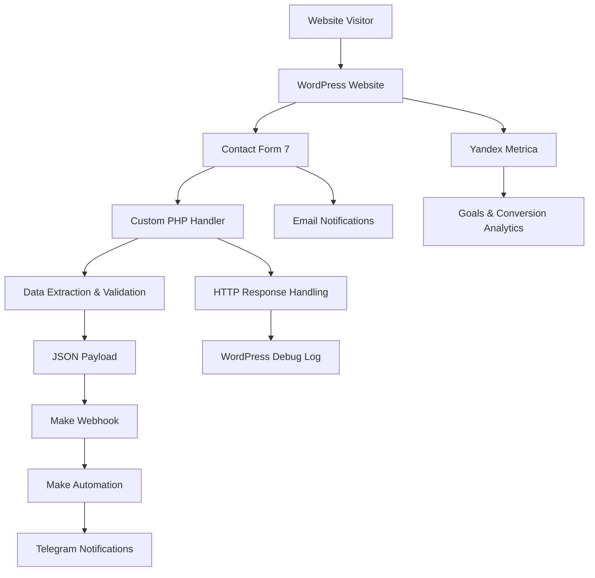

# Fin Help Center — Web Platform & Lead Automation

A WordPress-based lead generation platform with custom form processing, webhook integrations, automated notifications, and conversion tracking.

## Project Overview

Fin Help Center is a web platform designed to attract potential clients interested in legal consultation services.

The project involved website development, custom functionality, third-party service integrations, lead processing automation, and marketing analytics.

**Project type:** Web Development / Technical Integration / Marketing Automation

**Website:** https://fin-help-center.ru/

## Key Features & Implementation

### 1. WordPress Development
- Website configuration and customization.
- Custom functionality using PHP and JavaScript.
- WordPress code customization through WPCode.
- Contact Form 7 configuration and integration.
- Frontend customization using HTML, CSS, and JavaScript.

### 2. Form Processing & Automation
- Contact Form 7 form configuration.
- Custom PHP integration using WordPress hooks.
- Webhook integration with Make.
- Automated lead data transfer using JSON payloads.
- Telegram notifications through Make.
- Email notifications.

### 3. Analytics & Tracking
- Yandex Metrica integration.
- Conversion goal configuration.
- UTM parameter tracking.
- Traffic source attribution.
- User behavior and conversion analysis.

### 4. SEO & Website Optimization
- On-page SEO optimization.
- Internal linking structure.
- Search engine indexing management.
- Website content and structure improvements.

## System Architecture

The lead processing workflow connects website forms, custom PHP functionality, external automation services, and notification channels.

## Custom PHP Integration

### Contact Form 7 → Make Webhook

Implemented a custom PHP integration using the `wpcf7_before_send_mail` WordPress hook.

The integration processes form submissions and transfers lead data to Make through an HTTP POST request.

**Implementation details:**
- Form-specific submission handling.
- Extraction of submitted form fields.
- Input normalization and validation.
- JSON payload generation.
- HTTP requests using WordPress `wp_remote_post()`.
- HTTP response status validation.
- Error handling through `WP_Error` checks.
- Logging of connection and HTTP errors.

### JSON Payload Structure

The integration transfers the following data:

| Field | Description |
|---|---|
| `user_name` | User name |
| `phone` | Contact phone number |
| `debt` | Selected debt information |
| `source` | Website identifier |
| `sent_at` | Submission timestamp |

### Configuration & Security

- Webhook URL stored separately in `wp-config.php`.
- Production credentials excluded from the repository.
- Required field validation before external requests.
- Separate handling of transport errors and HTTP response errors.

## Technology Stack

| Category | Technologies |
|---|---|
| CMS | WordPress |
| Backend | PHP |
| Frontend | HTML, CSS, JavaScript |
| Forms | Contact Form 7 |
| Customization | WPCode |
| Automation | Make |
| Integration | Webhooks, HTTP POST, JSON |
| Notifications | Telegram Bot |
| Analytics | Yandex Metrica |
| SEO | On-page optimization |

## Error Handling & Monitoring

The custom integration distinguishes between:

- Successful HTTP responses (2xx).
- HTTP client and server errors (4xx / 5xx).
- WordPress transport errors (`WP_Error`).

Diagnostic messages are recorded in the WordPress debug log.

## Skills Demonstrated

- WordPress customization and troubleshooting.
- PHP development and backend integration.
- JavaScript and frontend customization.
- REST/HTTP-based service integration.
- Webhook-based data exchange.
- JSON payload processing.
- Business process automation.
- Technical troubleshooting and error handling.
- Marketing analytics and conversion tracking.
- SEO and website optimization.

## Project Scope

This case study documents selected technical implementations and integration work performed on the platform.

The repository contains sanitized code examples and configuration templates. Production credentials, personal data, and sensitive business information are intentionally excluded.

## Future Improvements

- Retry mechanism for failed webhook requests.
- Persistent lead delivery queue.
- Extended integration monitoring.
- Structured logging and execution tracking.
- Further SEO and performance optimization.

---

*Independent technical case study by Roman.*
