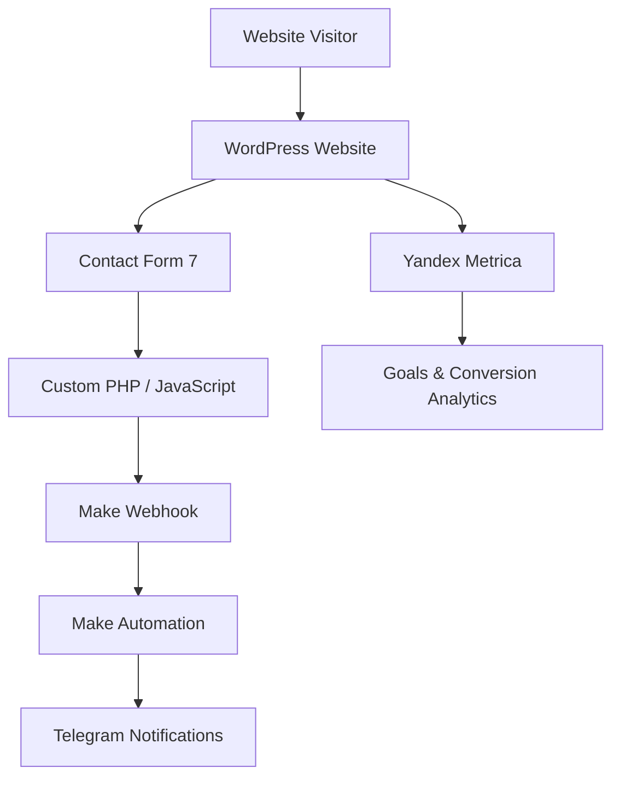

# Fin Help Center — Web Platform & Lead Automation

A WordPress-based lead generation platform with custom form processing, webhook integrations, automated notifications, and conversion tracking.

## Project Overview

Fin Help Center is a web platform designed to attract potential clients interested in legal consultation services.

The project involved website development, custom functionality, integration of external services, lead processing automation, and marketing analytics.

**Project type:** Web Development / Technical Integration / Marketing Automation

**Website:** https://fin-help-center.ru/

## Key Features & Implementation

### 1. WordPress Development
- Website configuration and customization.
- Custom functionality using PHP and JavaScript.
- WordPress code customization through WPCode.
- Contact Form 7 configuration and integration.

### 2. Form Processing & Automation
- Contact Form 7 form configuration.
- Custom PHP and JavaScript functionality.
- Integration with Make using Webhooks.
- Automated lead data transfer.
- Telegram notifications through Make.

### 3. Analytics & Tracking
- Yandex Metrica integration.
- Conversion goal configuration.
- UTM parameter tracking.
- Traffic source attribution.
- User behavior and conversion analysis.

### 4. SEO & Website Optimization
- On-page SEO optimization.
- Internal linking structure.
- Search engine indexing management.
- Website content and structure improvements.

## System Architecture

## Technology Stack

| Category | Technologies |
|---|---|
| CMS | WordPress |
| Backend | PHP |
| Frontend | JavaScript |
| Forms | Contact Form 7 |
| Customization | WPCode |
| Automation | Make |
| Integration | Webhooks |
| Notifications | Telegram |
| Analytics | Yandex Metrica |

## Skills Demonstrated

- WordPress customization and troubleshooting.
- PHP and JavaScript integration.
- Webhook-based system integration.
- Business process automation.
- Form processing and lead data transfer.
- Marketing analytics and conversion tracking.
- SEO and website optimization.

## Project Scope

This case study documents the technical implementation and integration work performed on the platform.

Sensitive business data, private configurations, credentials, and proprietary implementation details are intentionally excluded.

---

*Independent technical case study by Roman.*
